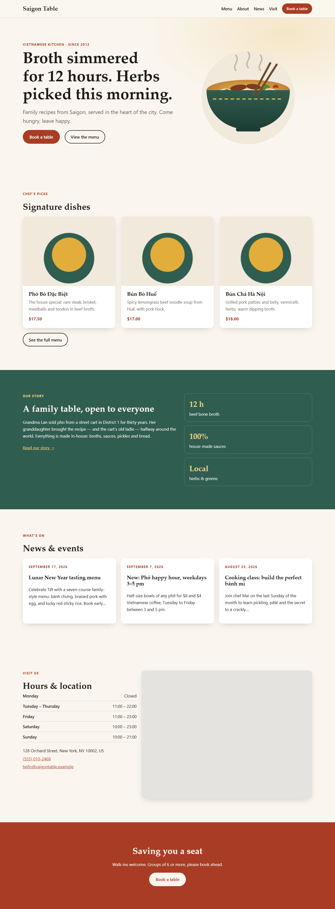

# Restaurant Website Template: WordPress · Nginx · Redis · Cloudflare

A fast, production-style marketing website for restaurants. Owners edit the menu, hours and news in WordPress. Nginx load-balances PHP and caches whole pages, Redis caches database lookups, and Cloudflare serves it to the world.

The whole stack runs locally with one command.



<p align="center">
  
  
  
</p>

## Results

| Configuration | Req/s | Median latency | DB queries / page |
|---|---:|---:|---:|
| No cache | 87 | 222 ms | 30.7 |
| + Redis object cache | 73 | 264 ms | **6** |
| + Nginx page cache | **18,365** | **0.6 ms** | **0** |

Measured with k6, 20 concurrent users, on a single Windows + Docker Desktop machine. Details and method: [benchmarks/results.md](benchmarks/results.md).

- **About 200× more throughput** with the full-page cache, and cached pages keep being served even when PHP is down.
- **Zero failed requests** when a PHP backend is killed in the middle of a load test (Nginx retries on the other backend).
- **Lighthouse 99–100** in Performance, Accessibility, Best Practices and SEO on mobile and desktop ([benchmarks/lighthouse.md](benchmarks/lighthouse.md)).
- Editing a price in wp-admin shows the new price **on the very next request**. Only the pages that display it are purged.

## Architecture

```
                         ┌──────────────────────────┐
  Browser ──HTTPS──▶     │  Cloudflare (DNS + CDN)  │  ← layer 3: edge cache
                         └────────────┬─────────────┘
                                      │ Cloudflare Tunnel (cloudflared)
                                      ▼
                         ┌──────────────────────────┐
                         │  Nginx                   │  ← layer 2: full-page cache
                         │  reverse proxy + LB      │    static files, rate limits
                         └──────┬───────────┬───────┘
                                │ FastCGI (least_conn)
                     ┌──────────▼──┐   ┌────▼────────┐
                     │ WordPress 1 │   │ WordPress 2 │   PHP-FPM replicas
                     └──────┬──────┘   └──────┬──────┘
                            │                 │
              ┌─────────────┴────┐   ┌────────┴────────┐
              │ MariaDB          │   │ Redis           │  ← layer 1: object cache
              └──────────────────┘   └─────────────────┘
```

| Layer | What it caches | Speeds up | Cleared by |
|---|---|---|---|
| 1. Redis object cache | Database query results, options, transients | Every PHP request, including wp-admin | WordPress itself (per key) |
| 2. Nginx `fastcgi_cache` | Complete HTML pages | Anonymous visitors (PHP never runs) | `mu-plugins/page-cache.php` deletes the affected pages' cache files |
| 3. Cloudflare edge | HTML + static assets, worldwide | Visitors far from the server | `mu-plugins/cloudflare-purge.php` calls the Cloudflare API with the same URLs |

## Features

**For the restaurant owner (wp-admin)**
- Menu items with price, category, dietary tags (vegan, gluten-free, spicy…) and a "feature on home page" switch
- **Settings → Restaurant**: phone, address, map and opening hours per day
- Table reservation form: bookings appear under **Reservations** in wp-admin
- News & events (regular posts), editable pages, and a full block theme you can change in the Site Editor
- "Purge page cache" button in the admin bar

**Under the hood**
- Custom block theme (`theme.json`, templates, patterns) with no page builder and no web-font requests
- SEO: meta description, Open Graph, and schema.org `Restaurant` JSON-LD (hours, address, menu)
- Page cache bypassed automatically for logged-in users, POST requests, query strings, `/wp-admin`, `/wp-json`, comment cookies
- Load balancing across PHP-FPM replicas with automatic failover
- Rate limiting on login (10/min) and the reservation form (6/min), security headers, `xmlrpc.php` and `wp-config.php` blocked
- WebP thumbnails, lazy-loaded images, 30-day static asset caching
- Backups, reproducible benchmarks, and CI (lint + full-stack smoke test)

## Quick start

Requirements: [Docker Desktop](https://www.docker.com/products/docker-desktop/) (running).

**Windows (PowerShell)**

```powershell
copy .env.example .env        # then change the passwords in .env
powershell -ExecutionPolicy Bypass -File scripts\setup.ps1
```

**Linux / macOS / Git Bash**

```bash
cp .env.example .env          # then change the passwords in .env
bash scripts/setup.sh
```

Open **http://localhost:8080**. The admin area is at **http://localhost:8080/wp-admin** (user and password come from `.env`).

The setup script builds the images, installs WordPress, activates the theme, loads the demo restaurant ("Saigon Table") and enables the Redis object cache. It is safe to run again; it never overwrites your edits.

## Everyday commands

```powershell
docker compose up -d                          # start
docker compose down                           # stop (data is kept in volumes)
docker compose logs -f nginx wordpress        # watch logs

# WP-CLI
docker compose run --rm wpcli plugin list
docker compose run --rm wpcli redis status            # object cache
docker compose run --rm wpcli page-cache status       # how many pages Nginx has cached
docker compose run --rm wpcli page-cache flush        # clear the page cache
docker compose run --rm wpcli page-cache purge http://localhost:8080/menu/

# Scale PHP backends
docker compose up -d --scale wordpress=3

# Is a page cached? Which backend answered?
curl.exe -sI http://localhost:8080/menu/ | findstr /i x-cache-status
curl.exe -sI -H "X-Debug: 1" -b "wordpress_no_cache=1" http://localhost:8080/menu/ | findstr /i x-upstream

# Benchmarks, tests, backups
powershell -ExecutionPolicy Bypass -File scripts\benchmark-suite.ps1   # regenerate benchmarks/results.md
powershell -ExecutionPolicy Bypass -File scripts\benchmark.ps1 -Label "my test" [-Bypass]
bash scripts/smoke-test.sh                                             # 19 end-to-end checks
powershell -ExecutionPolicy Bypass -File scripts\backup.ps1            # -> backups\<timestamp>\
powershell -ExecutionPolicy Bypass -File scripts\restore.ps1 -Backup <timestamp>
```

## How the page cache stays fresh

Visitors must never see an old price, but the page should also not be rebuilt more often than needed. When content changes, `wordpress/mu-plugins/page-cache.php` works out exactly which pages show it:

| Change | Pages purged |
|---|---|
| Menu item (price, name, tags) | the dish page, `/menu/`, the home page, its category page |
| News post | the post, `/news/`, the home page, its category/tag pages |
| Opening hours, site name, navigation, theme or template edits | everything (they appear in the header/footer of every page) |

Nginx stores each page as a file named `md5("GET" + host + URI)`. The plugin rebuilds that key, deletes the file, and fires `rc_page_cache_purged`, which the Cloudflare plugin uses to purge the same URLs at the edge. Nginx and PHP run as the same user (uid 33) and share the cache volume, which is why the Nginx image is Debian-based rather than Alpine.

## Going public

The site can be published at your own domain through **Cloudflare Tunnel**, with no router configuration needed. Step-by-step guide: **[docs/cloudflare.md](docs/cloudflare.md)**.

```powershell
# after adding CF_TUNNEL_TOKEN and SITE_URL=https://... to .env
docker compose --profile tunnel up -d
```

## Project structure

```
├── docker-compose.yml          # db, redis, nginx, wordpress (x2), wpcli, k6, cloudflared
├── .env.example                # all settings; copy to .env
├── nginx/
│   ├── nginx.conf              # real IP, gzip, rate-limit zones
│   ├── conf.d/site.conf        # upstream (load balancer), locations, cache use
│   ├── conf.d/cache.conf       # cache zone, key, bypass rules, CDN header
│   └── snippets/               # FastCGI params, blocked paths, security headers
├── redis/redis.conf            # 128 MB, allkeys-lru, no persistence
├── wordpress/
│   ├── Dockerfile              # php-fpm + phpredis + tuned pool
│   ├── wp-config-extra.php     # URL, HTTPS-behind-proxy, Redis settings from env
│   ├── mu-plugins/
│   │   ├── restaurant-core/    # menu, hours, reservations, SEO, performance
│   │   ├── page-cache.php      # Nginx cache purging + `wp page-cache`
│   │   └── cloudflare-purge.php
│   └── themes/restaurant-theme/
├── scripts/                    # setup, seed, benchmark, smoke test, backup/restore
├── benchmarks/                 # k6 script, results.md, lighthouse.md
├── docs/cloudflare.md
└── .github/workflows/ci.yml    # lint + full-stack smoke test on every push
```

## Lessons learned

Things that broke or surprised me while building this, and what fixed them:

1. **The object cache didn't make pages faster, but the page cache made them 200× faster.** Redis cut database queries by 80%, but on one machine a Redis lookup costs about as much as the local MariaDB query it replaces, and PHP rendering was the real bottleneck. The object cache pays off when the database is remote or overloaded. The page cache pays off because it skips PHP entirely.
2. **Nginx resolves hostnames once at startup.** After the WordPress container was recreated with a new IP, every request got a 502. Fix: `resolver 127.0.0.11` plus `server wordpress:9000 resolve`, which is also what lets Nginx discover new replicas automatically.
3. **`keepalive` to PHP-FPM caused 25–58 s stalls.** An FPM worker serves one connection at a time, so idle kept-alive connections from 12 Nginx workers pinned all of them. Removing `keepalive` fixed the long tail.
4. **A cache must fail open.** With Redis stopped, the site returned HTTP 500 until `WP_REDIS_GRACEFUL` was set. It still slows down while Redis is *removed*, because Docker DNS forwards the unknown hostname to the host resolver (4–8 s). A crashed Redis is restarted by Docker within seconds.
5. **`add_header` is not inherited.** Any `location` with its own `add_header` silently drops the server-level ones, so security headers live in a snippet included in every location.
6. **Cache invalidation is the hard part.** Serving from cache was one directive; deciding *which* pages to purge for each kind of change, and proving it with tests, was most of the work.
7. **Windows tooling quirks:** Git Bash rewrote `/%postname%/` into `C:/Program Files/Git/%postname%/` (fixed with `MSYS_NO_PATHCONV=1`); Windows PowerShell 5 treats Docker's stderr progress output as errors and adds a byte-order mark to UTF-8 files; binary backups must be copied with `docker compose cp`, not piped.

## Troubleshooting

| Problem | Fix |
|---|---|
| `failed to connect to the docker API` | Start Docker Desktop and wait until it says "Engine running". |
| Port 8080 already in use | Change `HTTP_PORT` and `SITE_URL` in `.env`, then `docker compose up -d`. |
| Change in wp-admin not visible | Logged-in users bypass the cache, so check in a private window. Use **Purge page cache** in the admin bar or `wpcli page-cache flush`. |
| "Error establishing a database connection" right after start | MariaDB is still initializing. Wait 10–20 s. |
| 502 Bad Gateway | `docker compose ps` and `docker compose logs wordpress`. A PHP container is down. |
| Scripts fail with `\r` errors | Files have Windows line endings. `.gitattributes` forces LF; re-clone or run `git add --renormalize .`. |

## License

GPL-2.0-or-later (same as WordPress).
